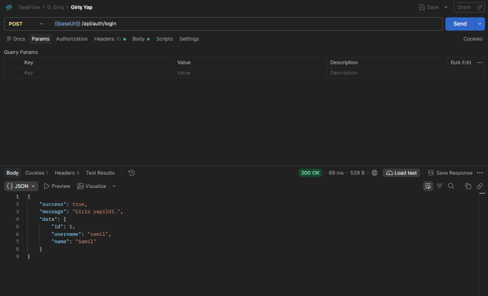
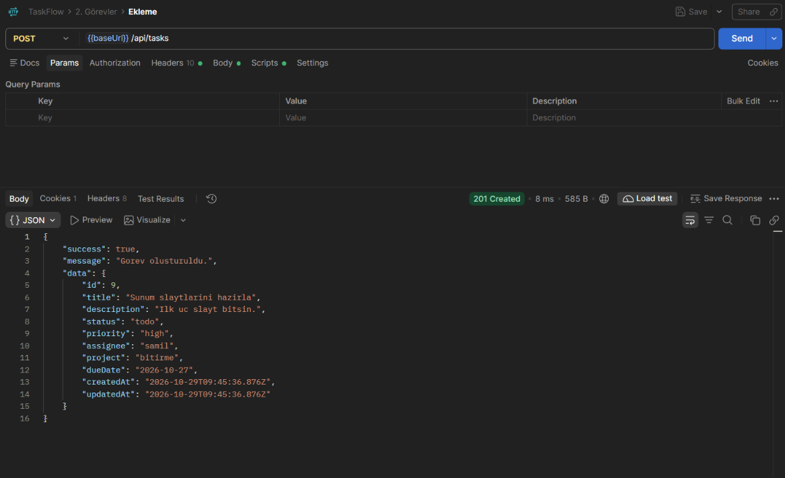
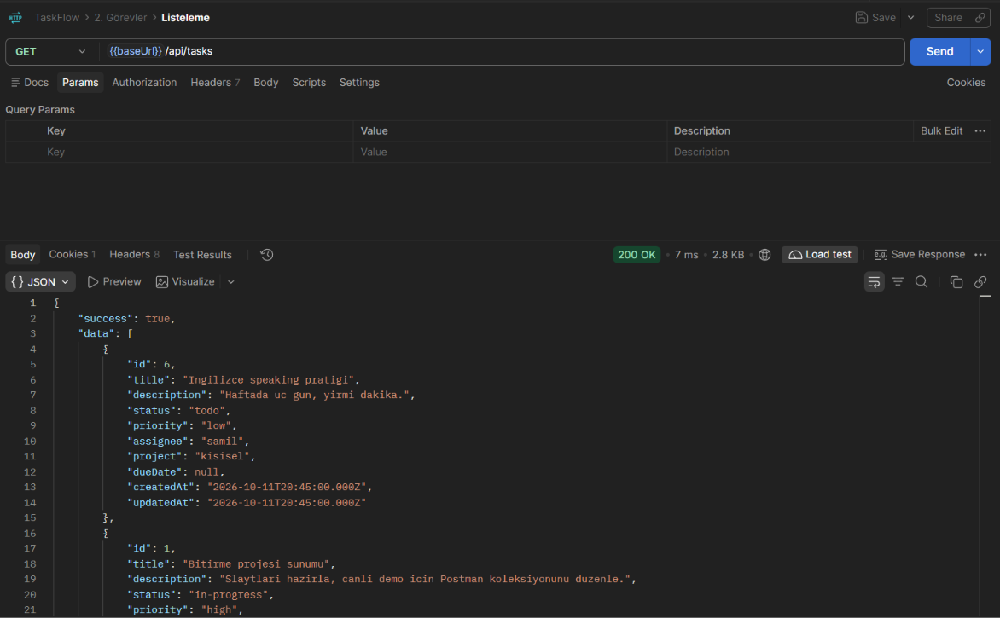
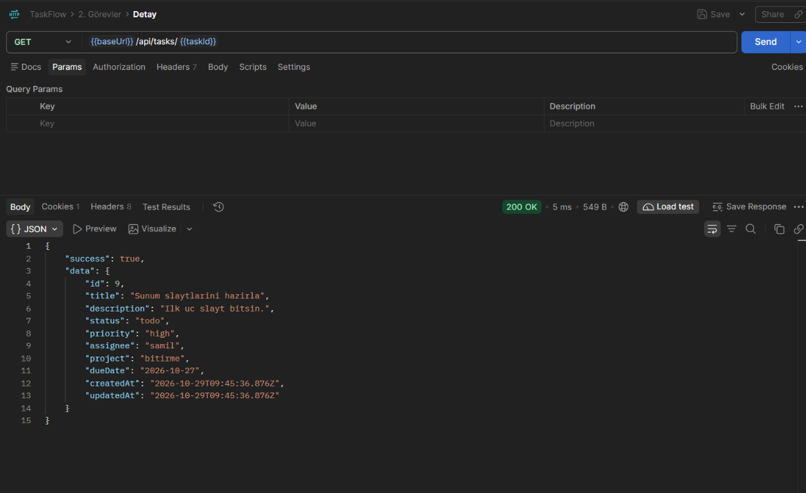
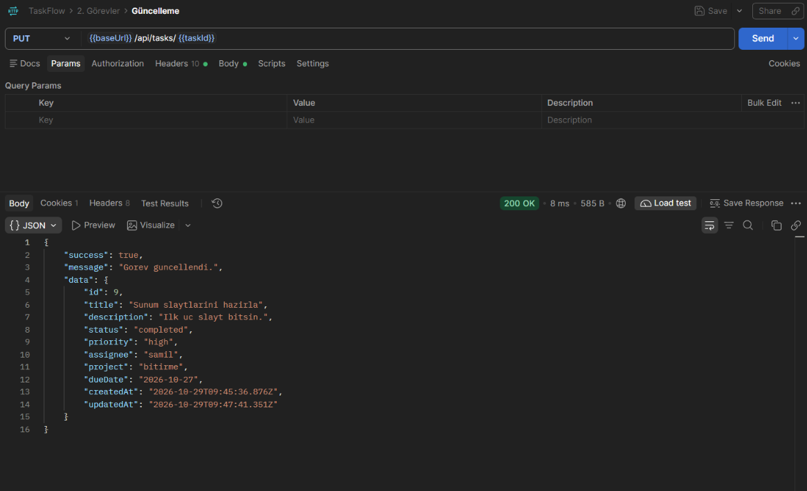
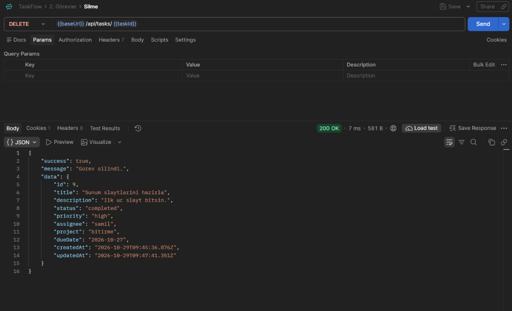

# TaskFlow

TaskFlow, kendi günlük işlerimi ve okul projelerimi takip ettiğim küçük bir görev
API'si. Node.js ve Express kullandım, verileri JSON dosyasında tutuyorum.
Veritabanı kurmak istemedim.

Giriş için session + çerez kullanıyorum. Görev ve rapor uçlarına erişmek için önce
giriş yapmak gerekiyor.

## Neler var

- Kayıt, giriş, çıkış ve "ben kimim" uçları (session tabanlı)
- Görev ekleme, listeleme, detay, güncelleme (`PUT` ve `PATCH`), silme
- Bozuk JSON dahil her isteği konsola ve `logs/access.log` dosyasına yazan logger
- Alan doğrulama: `title` ve `assignee` zorunlu, `priority` ve `status` belli değerlerden biri
- Durum, öncelik, kişi ve projeye göre filtreleme
- Başlık/açıklamada arama, sıralama, sayfalama
- Tamamlanan / bekleyen / genel özet için üç rapor ucu
- `npm test` ile 27 otomatik test (giriş, CRUD, doğrulama, hata, loglama, eşzamanlı yazma)

## Kurulum

Node.js 18.8 veya üzeri gerekiyor.

```bash
git clone https://github.com/samil07kocakavuk/taskflow.git
cd taskflow
npm install
```

Ayarları `.env` dosyasından okumak istersen örneği kopyala:

```bash
# PowerShell
Copy-Item .env.example .env
```

`PORT`, `SESSION_SECRET` ve dosya yolları buradan değiştirilebiliyor. `.env`
git'e eklenmiyor.

## Çalıştırma

```bash
npm start
```

Sunucu `http://localhost:3000` adresinde açılır. Port değiştirmek istersen:

```bash
# PowerShell
$env:PORT=4000; npm start
```

Geliştirirken `npm run dev` kullanıyorum; dosya değişince sunucu kendini yeniliyor.

## Giriş

Hazır kullanıcı: **`samil` / `123456`**

```bash
curl -X POST http://localhost:3000/api/auth/login \
  -H "Content-Type: application/json" \
  -d '{"username":"samil","password":"123456"}' \
  -c cookie.txt
```

Dönen `taskflow.sid` çerezini sonraki isteklerde göndermen gerekiyor:

```bash
curl http://localhost:3000/api/tasks -b cookie.txt
```

Yeni kullanıcı için `POST /api/auth/register` kullanılıyor. Şifreler `scrypt` ile
hashlenip `data/users.json` içinde tutuluyor, düz metin yok.

## Uçlar

| Metot | Yol | Ne yapıyor |
|---|---|---|
| GET | `/api/health` | Sunucu ayakta mı (giriş gerekmez) |
| POST | `/api/auth/register` | Kayıt |
| POST | `/api/auth/login` | Giriş |
| POST | `/api/auth/logout` | Çıkış |
| GET | `/api/auth/me` | Oturumdaki kullanıcı |
| GET | `/api/tasks` | Görevleri listeler |
| POST | `/api/tasks` | Yeni görev ekler |
| GET | `/api/tasks/:id` | Tek görev getirir |
| PUT | `/api/tasks/:id` | Görevi günceller |
| PATCH | `/api/tasks/:id` | Görevi kısmi günceller |
| DELETE | `/api/tasks/:id` | Görevi siler |
| GET | `/api/tasks/search?keyword=` | Başlık/açıklamada arar |
| GET | `/api/tasks/assignee/:assignee` | Kişiye atanan görevler |
| GET | `/api/reports/completed` | Tamamlananlar |
| GET | `/api/reports/pending` | Bekleyenler |
| GET | `/api/reports/summary` | Genel özet |

Giriş gerektiren uçlar oturum yoksa `401` dönüyor.

Listeleme şu parametreleri alıyor: `status`, `priority`, `assignee`, `project`,
`keyword`, `sort`, `page`, `limit`. Örnek:

```
GET /api/tasks?status=todo&sort=-createdAt&page=1&limit=10
```

`sort` için `createdAt`, `updatedAt`, `priority`, `title`, `dueDate`, `id`
kullanılabilir. Azalan sıralama için başına `-` koyuyorum (`sort=-createdAt`).

## Örnek

Giriş yaptıktan sonra:

```bash
curl -X POST http://localhost:3000/api/tasks \
  -H "Content-Type: application/json" \
  -b cookie.txt \
  -d '{"title":"Sunum slaytlarini hazirla","priority":"high","assignee":"samil"}'
```

```bash
curl -X PATCH http://localhost:3000/api/tasks/1 \
  -H "Content-Type: application/json" \
  -b cookie.txt \
  -d '{"status":"completed"}'
```

## Klasörler

```
data/tasks.json       gorevler
data/users.json       kullanicilar (hashli sifre)
docs/                 tanitim, veri modeli, api dokumani
postman/              postman koleksiyonu
screenshots/          Postman ekran goruntuleri
src/config            ayarlar
src/controllers       istek/cevap
src/middleware        logger, validation, oturum kontrolu, hata yakalama
src/routes            rotalar
src/services          is mantigi
src/utils             yardimci dosyalar
test/                 api testleri
```

## Veri

Görevler `data/tasks.json` içinde duruyor:

```json
{
  "nextId": 9,
  "tasks": [ { "id": 1, "title": "...", "...": "..." } ]
}
```

`nextId` sayesinde silinen bir görevin numarası yeni göreve tekrar verilmiyor.
Dosyaya yazarken önce geçici dosyaya yazıp sonra üzerine taşıyorum, böylece aynı
anda gelen isteklerde yarım dosya okunmuyor. Yazma işlemleri sıraya alınıyor.

## Test

```bash
npm test
```

Testler geçici dosyalarla çalışıyor, `data/` içindeki verilere dokunmuyor.

## Postman

`postman/taskflow.postman_collection.json` dosyasını Postman'e import et.
`baseUrl` değişkeni `http://localhost:3000` geliyor.

**Önce `0. Giriş` klasöründeki `Giriş Yap` isteğini çalıştır.** Postman çerezi
kendisi saklıyor, sonraki istekler oturumlu gidiyor.

## Ekran Görüntüleri

Postman'de giriş ve temel CRUD isteklerinin kanıtları:













## Notlar

- Session'lar sunucu belleğinde; sunucu yeniden başlarsa tekrar giriş yapmak gerekir.
- `SESSION_SECRET` ortam değişkeniyle değiştirilebilir.
- Aynı anda birden fazla sunucu aynı dosyaya yazarsa kuyruk işe yaramaz. Tek
  process için tasarladım.

Dokümanlar: [tanıtım](docs/Proje-Tanitim-Dokumani.md) ·
[veri modeli](docs/Veri-Modeli.md) · [API](docs/API-Dokumani.md) ·
[test senaryoları](docs/Test-Senaryolari.md) · [teslim raporu](docs/Teslim-Raporu.md)
