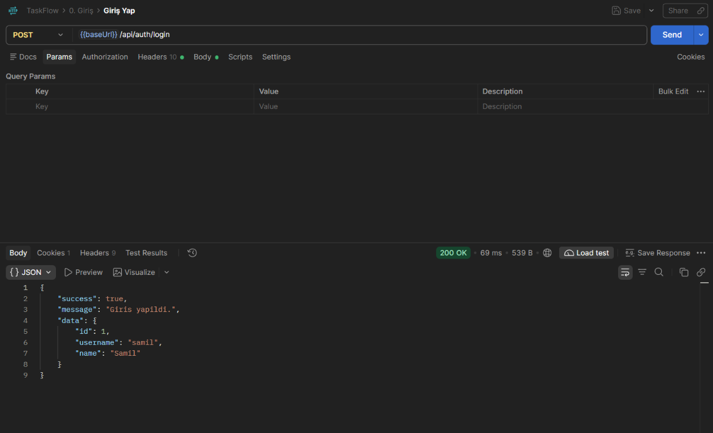
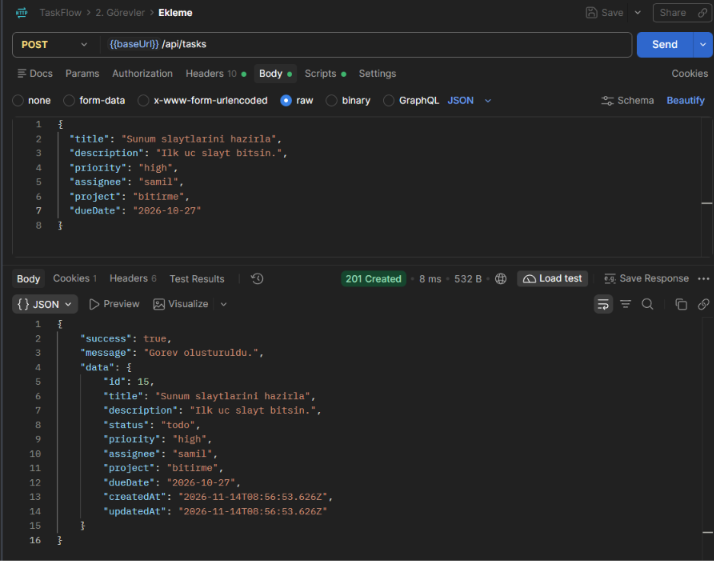
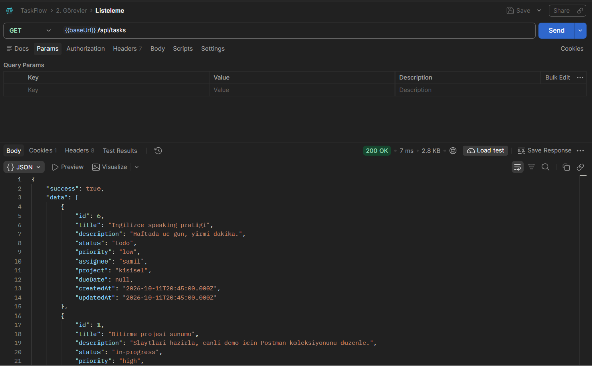

# TaskFlow

TaskFlow, görevlerin oluşturulması, çalışanlara atanması ve durum/öncelik bazında izlenmesi için geliştirilmiş bir REST API'dir. Node.js ve Express.js kullanır; veriler JSON dosyalarında tutulur. Görev ve rapor uçları session tabanlı kimlik doğrulama ile korunur.

## Gereksinimler

- Node.js 18.8 veya üzeri
- npm

## Kurulum

```bash
git clone https://github.com/samil07kocakavuk/taskflow.git
cd taskflow
npm install
```

Ortam değişkenlerini değiştirmek için `.env.example` dosyasını `.env` olarak kopyalayın:

```bash
# PowerShell
Copy-Item .env.example .env
```

## Çalıştırma

```bash
npm start
```

Sunucu varsayılan olarak `http://localhost:3000` adresinde çalışır. Farklı port için:

```bash
# PowerShell
$env:PORT=4000; npm start
```

Geliştirme sırasında `npm run dev` kullanılabilir. Bu komut dosya değişikliklerinde sunucuyu yeniden başlatır ve Node.js 18.11 veya üzeri gerektirir.

## Giriş

Hazır kullanıcı: `samil` / `123456`

```bash
curl -X POST http://localhost:3000/api/auth/login \
  -H "Content-Type: application/json" \
  -d '{"username":"samil","password":"123456"}' \
  -c cookie.txt
```

Dönen `taskflow.sid` çerezi sonraki isteklerde gönderilir:

```bash
curl http://localhost:3000/api/tasks -b cookie.txt
```

Yeni kullanıcı `POST /api/auth/register` ile oluşturulur. Şifreler düz metin olarak tutulmaz.

## Uçlar

| Metot | Yol | İşlev |
|---|---|---|
| GET | `/api/health` | Sunucu durumu (giriş gerekmez) |
| POST | `/api/auth/register` | Kullanıcı kaydı |
| POST | `/api/auth/login` | Giriş |
| POST | `/api/auth/logout` | Çıkış |
| GET | `/api/auth/me` | Oturumdaki kullanıcı |
| GET | `/api/tasks` | Görevleri listeler |
| POST | `/api/tasks` | Görev ekler |
| GET | `/api/tasks/:id` | Görev detayı |
| PUT | `/api/tasks/:id` | Görevi günceller |
| PATCH | `/api/tasks/:id` | Görevi kısmi günceller |
| DELETE | `/api/tasks/:id` | Görevi siler |
| GET | `/api/tasks/search?keyword=` | Başlık ve açıklamada arar |
| GET | `/api/tasks/assignee/:assignee` | Kişiye atanan görevleri listeler |
| GET | `/api/reports/completed` | Tamamlanan görevler |
| GET | `/api/reports/pending` | Bekleyen görevler |
| GET | `/api/reports/summary` | Genel özet |

Görev ve rapor uçları oturum yoksa `401` döner.

## Listeleme Parametreleri

`GET /api/tasks` şu parametreleri kabul eder:

| Parametre | Örnek | Açıklama |
|---|---|---|
| `status` | `completed` | `todo`, `in-progress`, `completed` |
| `priority` | `high` | `low`, `medium`, `high` |
| `assignee` | `samil` | Atanan kişi |
| `project` | `bitirme` | Proje adı |
| `keyword` | `sunum` | Başlık ve açıklamada arama |
| `sort` | `-createdAt` | `createdAt`, `updatedAt`, `priority`, `title`, `dueDate`, `id` |
| `page` | `1` | Sayfa numarası |
| `limit` | `10` | Sayfa başına kayıt (en fazla 100) |

Örnek:

```text
GET /api/tasks?status=todo&priority=high&sort=-createdAt&page=1&limit=10
```

Azalan sıralama için alan adının başına `-` eklenir.

## Örnek İstekler

Görev ekleme:

```bash
curl -X POST http://localhost:3000/api/tasks \
  -H "Content-Type: application/json" \
  -b cookie.txt \
  -d '{"title":"Sunum slaytlarını hazırla","priority":"high","assignee":"samil"}'
```

Görev güncelleme:

```bash
curl -X PATCH http://localhost:3000/api/tasks/1 \
  -H "Content-Type: application/json" \
  -b cookie.txt \
  -d '{"status":"completed"}'
```

## Proje Yapısı

```text
src/
  config/        ayarlar
  controllers/   istek ve yanıt işlemleri
  middleware/    logger, doğrulama, oturum ve hata yönetimi
  routes/        API rotaları
  services/      veri işlemleri
  utils/         yardımcı dosyalar
  app.js
  server.js
test/            API testleri
data/            JSON veri dosyaları
docs/            proje dokümanları
postman/         Postman koleksiyonu
screenshots/     Postman ekran görüntüleri
```

## Veri Saklama

Görevler `data/tasks.json`, kullanıcılar `data/users.json` içinde tutulur. Dosyalar yoksa ilk çalıştırmada oluşturulur. Yazma işlemleri sıraya alınır; yarım dosya okunmasını önlemek için geçici dosya kullanılır.

## Test

```bash
npm test
```

Testler geçici dosyalarla çalışır ve `data/` içindeki verilere dokunmaz.

## Postman

`postman/taskflow.postman_collection.json` dosyasını Postman'e import edin. İsteklerden önce `0. Giriş` klasöründeki `Giriş Yap` isteğini çalıştırın; Postman çerezi sonraki isteklerde kullanır.

`baseUrl` değişkeni varsayılan olarak `http://localhost:3000` değerini alır.

Koleksiyondaki 25 isteğin her birinde `pm.test` doğrulaması vardır. Collection Runner ile çalıştırıldığında 25 istek ve 53 doğrulama hatasız geçer. Terminalden:

```bash
npx newman run postman/taskflow.postman_collection.json
```

## Ekran Görüntüleri







Diğer ekran görüntüleri `screenshots/` klasöründe yer alır.

## Notlar

- Session'lar sunucu belleğinde tutulur; sunucu yeniden başlarsa tekrar giriş yapılması gerekir.
- `PORT`, `SESSION_SECRET` ve dosya yolları `.env` üzerinden değiştirilebilir.
- Proje tek sunucu süreci için tasarlanmıştır.

## Dokümanlar

- [Proje tanıtımı](docs/Proje-Tanitim-Dokumani.md)
- [Veri modeli](docs/Veri-Modeli.md)
- [API dokümanı](docs/API-Dokumani.md)
- [Test senaryoları](docs/Test-Senaryolari.md)
- [Teslim raporu](docs/Teslim-Raporu.md)
